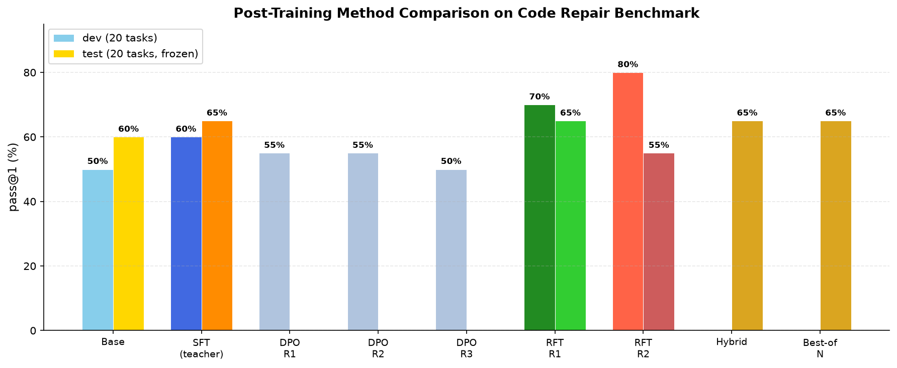
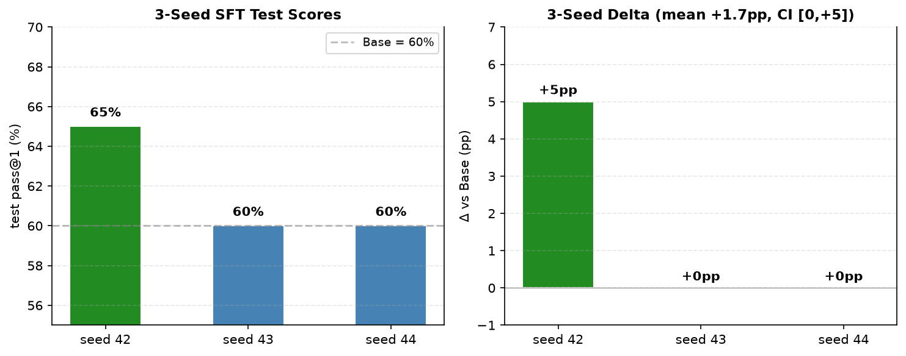
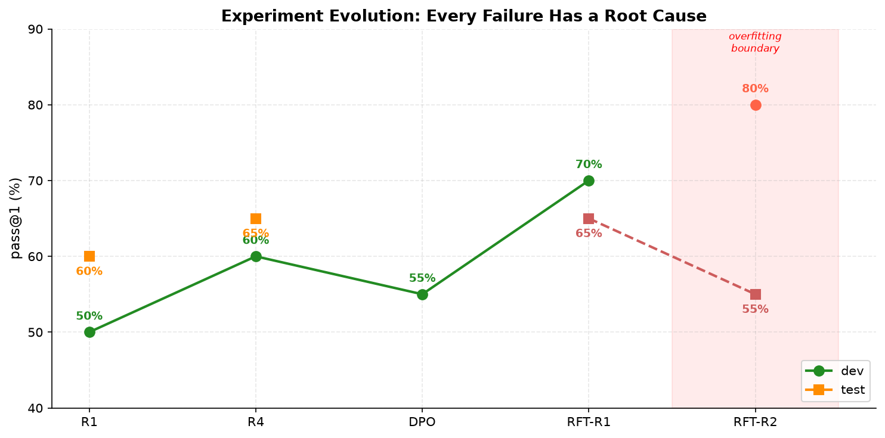

# CodeAgent-R


**中文** | [English](README_EN.md)

面向代码修复的后训练实验平台。对 Qwen2.5-Coder-7B 系统性尝试了 6 种后训练方法（教师蒸馏 SFT / DPO×3 / RFT×2 / 混合训练 / Best-of-N 推理），每种方法都有根因分析。

## 方法对比



## 最终成绩单

| 方法 | dev | test | 判定 |
|---|---|---|---|
| Base greedy | 50% | 60% | 起点 |
| SFT（教师蒸馏） | 60% | **65%** | ✅ 部署 |
| DPO 第 1 轮（SFT ref，统一 β） | 55% | — | ❌ σ→0 梯度趋零 |
| DPO 第 2 轮（SFT ref，自适应 β） | 55% | — | ❌ 同上（β 非根因） |
| DPO 第 3 轮（Base ref） | 50% | — | ❌ 学会排序但执行退化 |
| **RFT 第 1 轮（自我改进）** | **70%** | **65%** | ✅ **最优可部署** |
| RFT 第 2 轮 | 80% | 55% | ❌ 过拟合边界 |
| Hybrid（教师+RFT 混合） | — | 65% | 无突破 |
| Best-of-N 推理（4 samples） | — | 65% | 无突破 |

**test 天花板 = 65%**：7 个任务对所有方法失败，当前 7B 模型 + 104 题池的硬上限。

### 3-seed 复现（SFT）

| seed | dev 决策 | test | Δ (pp) |
|---|---|---|---|
| 42 | epoch-3 部署 | 65% | +5.0 |
| 43 | **保留 Base**（dev 无增益） | 60% | 0 |
| 44 | epoch-2 部署 | 60% | 0 |
| **汇总** | — | — | **均值 +1.7，CI [0, +5]，零退化** |



## 实验演进



| 轮次 | 改动 | 样本 | 评测集 | 结果 | 根因 |
|---|---|---|---|---|---|
| 1 | 初版 SFT | 71 | 2/2 题 | 输出与 Base 逐字节相同 | 数据不足，只学风格 |
| 2 | 扩至 84 题 | 204 | 12/12 题 | dev +1 / test −1 | 评测集噪声；隐藏测试不完备 |
| 3 | 修标签"一题一解" | 60 | 12/12 题 | 无变化 | 监督 token 砍到 26%，饿死 |
| **4** | **104 题+变异审计+3 seed** | **202** | **20/20 题** | **+1.7pp，零退化** | 数据×2.8+质量门槛+分辨率×1.7 |
| 5-7 | DPO 三轮 | 50 对 | dev 20 题 | 全负 | σ→0 / 偏好≠执行 / 过拟合 |
| 8 | RFT 第 1 轮 | 150 自生成 | dev 20 题 | **dev +10pp** | 同分布自我强化有效 |
| 9 | RFT 第 2 轮 | 180 自生成 | dev 20 题 | dev +10 test −10 | 迭代自我改进有边界 |

## 方法论发现

1. **教师蒸馏有分布偏移天花板**：教师答案风格与模型自身分布有差异，SFT 学到 65% 后难以继续提升
2. **DPO 的三种失败模式**：SFT 自引用致梯度趋零（σ→0）、自适应 β 不能解决结构性问题、Base reference 产生真实梯度但偏好排序≠执行能力
3. **RFT 同分布自我强化最有效**：第 1 轮 +10pp dev，第 2 轮开始过拟合（dev↑ test↓）
4. **迭代自我改进有边界**：每轮收窄输出分布，Round 2 起 test 退化
5. **dev/test 来源组隔离 + 执行选型是关键防线**：DPO 不超 SFT 不上线、RFT-R2 test 退化被拦截、seed 43 无增益保留 Base

## 核心管线

| 能力 | 实现 |
|---|---|
| 任务基准 | 104 题 / 52 来源组，变异测试审计（幸存变异体 = 假标签检测） |
| 数据隔离 | 来源组冻结 64/20/20，候选指纹迁移（省 56% 采集成本） |
| SFT | NF4 QLoRA、assistant-only mask、监督 token 加权累积、每 epoch 不可变快照 |
| 模型选择 | dev **执行通过率**选型，Base 参与对照，平局保留 Base |
| DPO | FEST 自适应 β + hard-negative AST 聚类 + Base reference |
| RFT | 拒绝采样 + [FailForge](https://arxiv.org/abs/2608.08570) 失败恢复（诊断提示→重试→去提示训练） |
| 推理 | greedy + Best-of-N（公开测试过滤采样） |

## 快速开始

```bash
python -m pip install -e ".[dev]"
python -m pytest tests -q           # 470 tests
python -m agentlab doctor
```

GPU 训练与评测：

```bash
python -m pip install -e ".[dev,train,api]"
python -m pip check
```

完整流程：[操作入口](docs/START-HERE.md) | [实验结果](docs/EXPERIMENT-RESULTS.md) | [GPU 实验手册](docs/POSTTRAIN-GPU.md)

## 管线架构

```text
任务池（变异测试审计）→ 按来源组冻结划分 → train / dev / test
      ↓ 仅 train / dev
公开指令 + 缺陷代码 + 依赖 + 公开测试
      ↓
教师候选采集 → 三层判分 → 重放验证 → SFT 训练数据
      ↓
QLoRA SFT → 每 epoch 快照 → dev 执行选型 → test 终评
      ↓（可选）
RFT 自我改进 → DPO 偏好优化 → Best-of-N 推理
```

## 项目结构

```text
scripts/           数据准备、采集、训练、评测、RFT、合并、隐私审查
src/agentlab/
  benchmark/       任务、公开协议、三层 grader、变异测试审计
  training/        SFT / DPO 训练器、数据准备
  runtime/         工作区、执行、预算、快照
  trajectories/    同状态分支与偏好构造
  experiments/     实验合同与运行状态
  providers/       OpenAI 兼容 provider
docs/              实验结果、方法论文档
tests/             不依赖真实模型/API 的自动化验证
```

## 已知边界

- 评分会执行模型代码；生产使用需补容器与资源隔离。
- 完整 Agent 工具交互与在线 RL 尚未实现。
- 当前任务为单文件平铺 Python 修复；多文件修复需扩展输出协议。
- 7 个 test 任务对所有已尝试方法失败；当前 7B 模型 + 104 题池的天花板为 65%。
- `data/`、`results/`、`checkpoints/` 不入库。

项目结构受 [pi](https://github.com/earendil-works/pi) 启发，独立实现。

## References

- [SWE-Gym](https://arxiv.org/abs/2412.21139) — execution-feedback agent training (ICML 2025)
- [FailForge](https://arxiv.org/abs/2608.08570) — failure recovery via diagnostic hints (2026)
- [PerfCodeGen](https://arxiv.org/abs/2412.03578) — runtime execution feedback for iterative refinement
- [Self-Execution Simulation](https://arxiv.org/abs/2604.03253) — training models to simulate execution
- [GiFT](https://arxiv.org/abs/2502.11466) — self-generated data improves fine-tuning
- [FEST](https://arxiv.org/abs/2605.15012) — adaptive β / hard-negative selection for DPO
- [DPO](https://arxiv.org/abs/2305.18290) — Direct Preference Optimization (NeurIPS 2023)
- [RFT](https://arxiv.org/abs/2308.01825) — Rejection Sampling Fine-Tuning
- [GRPO](https://arxiv.org/abs/2402.03300) — Group Relative Policy Optimization

License: MIT.
