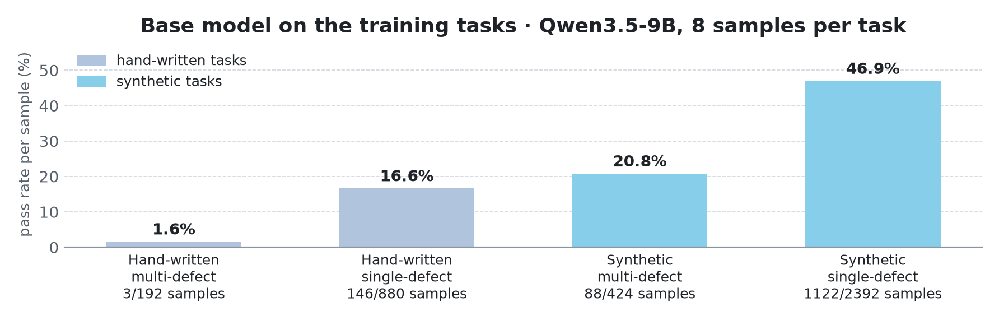
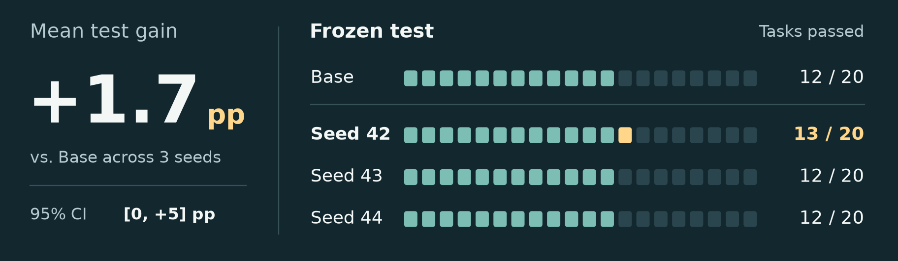

# CodeAgent-R

**代码修复模型的后训练与执行评测** · [English](README_EN.md)

[](https://github.com/Phoenix-chaser/CodeAgent-R/actions/workflows/checks.yml)     

CodeAgent-R 是一套可复现的代码修复后训练与评测流水线：冻结任务池、执行判分、QLoRA SFT / DPO / RFT、在 dev 上选型、在冻结的 test 上与基座模型（Base）配对比较。

默认模型是 **Qwen3.5-9B**，本文的结果以它为主，见下文「Qwen3.5-9B 上的结果」一节。后面「此前在 Qwen2.5-Coder-7B-Instruct 上的结果」是换成它之前的实验，任务池是 104 道自写的 Python 单文件修复题；复现那些结果时设置 `MODEL=Qwen/Qwen2.5-Coder-7B-Instruct`。


[Qwen3.5-9B 的结果](#qwen35-9b-上的结果) · [方法对比](#方法对比) · [三种子](#三种子复现) · [实验演进](#实验演进) · [评测流程](#训练与评测流程) · [结果如何保证可信](#结果如何保证可信) · [快速开始](#本地快速开始)

## 目录

1. [Qwen3.5-9B 上的结果](#qwen35-9b-上的结果)：结论、扩大题池后的 RFT、合成题的难度、默认题池、难度阶梯、RFT 与对照组、引导采样、两套评测的对照、下一步
2. [结果如何保证可信](#结果如何保证可信)：判分、隔离、统计、证据、CI
3. [此前在 Qwen2.5-Coder-7B-Instruct 上的结果](#此前在-qwen25-coder-7b-instruct-上的结果)：换成 Qwen3.5-9B 之前的实验
   - [方法对比](#方法对比)：Base、SFT、三轮 DPO、两轮 RFT、混合训练和 Best-of-N 的 dev 与 test 成绩
   - [三种子复现](#三种子复现)：三个训练种子各自的 dev 选型与冻结 test 上的结果
   - [实验演进](#实验演进)：各轮的训练数据与改动、当轮观察
     - [如何解读这些差异](#如何解读这些差异)
4. [训练与评测流程](#训练与评测流程)：按来源组冻结划分、重放教师候选、训练、dev 选型与 test 评测
5. [本地快速开始](#本地快速开始)：CPU 示例、离线测试、GPU 训练与评测
6. [项目结构与边界](#项目结构与边界)：代码与文档的位置，以及尚未实现的部分
7. [相关研究](#相关研究)：代码修复与执行反馈、自生成数据与拒绝采样、偏好优化与组内反馈

## Qwen3.5-9B 上的结果

**结论。** 在 Qwen3.5-9B 上，整套流程都跑通了：教师采集、RFT、引导采样、合成出题、扩大题池后的 RFT。微调带来的提升是同分布内的：扩大题池后 dev 整体约 +7 个点，涨的几乎都在合成题上；人写的题上没有变化。四次实验里，拿错误答案训练的对照组都和验证组一样高——在这个数据规模上，没有测出可归因于“正确答案”的提升。这些提升还只在 NF4 评测下出现：同一组模型在 vLLM（bf16）下重评，贪心通过数是基座 84、A-verified 85、C-control 76，提升没有出现（见「两套评测的对照」）。

**扩大题池后的 RFT（dev 165 题）。** 在扩大后的阶梯上重做 RFT，合成难题、合成变体两层也采样。训练数据 334 条，一道题一条，其中 269 条来自合成题；总数是第 1 轮 61 条的 5.5 倍。dev 165 题上贪心解码的通过数：

| 组 | 原有题 | 难题 | 变体 | 合成难题 | 合成变体 | 合计 | 其中人写的 66 道 |
| --- | ---: | ---: | ---: | ---: | ---: | ---: | ---: |
| Base | 14/20 | 0/8 | 15/38 | 0/15 | 39/84 | 68/165 | 29/66 |
| A-verified | 14/20 | 0/8 | 16/38 | 1/15 | 48/84 | 79/165 | 30/66 |
| C-control | 16/20 | 0/8 | 15/38 | 0/15 | 50/84 | 81/165 | 31/66 |


两组都比基座高 11–13 道，但涨的几乎全在合成题上：合成变体这一层，A-verified 相对基座新通过 16 道、丢了 7 道，C-control 新通过 12 道、丢了 1 道。人写的 66 道是 29 → 30 → 31，和第 1 轮一样在噪声内。

**合成题的难度。** 并入合成题以后，基座在训练集上每题采 8 次：

| 层 | 解出的题 | 通过的样本 |
| --- | ---: | ---: |
| 多缺陷难题（人写） | 2/24 | 3/192（1.6%） |
| 单缺陷变体（人写） | 63/110 | 146/880（16.6%） |
| 合成母题 | 23/53 | 88/424（20.8%） |
| 合成变体 | 246/299 | 1122/2392（46.9%） |



合成题是中等难度，比人写的题容易，变体尤其明显。

上面是这一轮最主要的结果；下面按时间顺序列出各项实验。

**设置。** 这一节的数字都来自把默认模型换成 Qwen3.5-9B 之后的实验。题池换成难度阶梯：原有题 104 道，加上难题池（40 道多缺陷题、183 道单缺陷变体），共 327 道，按来源族冻结划分，train 198 / dev 66 / test 63。评测是 NF4 量化下的贪心解码，按层报告（原有题、难题、变体；并入合成题以后再加合成难题、合成变体两层）；test 只在最后评一次。后来又并入教师生成、逐题执行审计过的合成题：两批共 545 道，结构同难题，每个题族是一道多缺陷母题加若干单缺陷变体。阶梯因此变成 872 道，train 550 / dev 165 / test 157。

**默认题池（104 道）。** 换成阶梯之前，先在默认题池上跑了一遍，成绩是：

| 方法 | dev | test |
| --- | ---: | ---: |
| Base | 11/20 | 16/20 |
| 教师蒸馏 SFT | 11/20 | — |
| RFT | 14/20 | 17/20 |
| RFT + Best-of-N | 15/20 | 18/20 |

教师蒸馏 SFT 只有 dev 成绩：和 Base 持平，没有提升；训练两三个 epoch 后反而降到 9/20。这 20 道 test 题被评过 4 次，Best-of-N 那个结果（test 18/20）的置信区间下界是 0，只能当作方向性的参考。

**难题池和难度阶梯。** 基座在 40 道多缺陷难题上贪心通过 0/40；教师在同样的题上能通过 94%，说明题目可解。教师答案的 SFT 在难题来源族上试了五次都没有提升，例如有一次 dev 从 15/46 降到 10/46，再到 12/46。在 327 道的阶梯上，基座贪心解码 dev 通过 29/66（原有题 14/20、难题 0/8、变体 15/38），test 通过 29/63（原有题 18/20、难题 0/8、变体 11/35）。

**阶梯上的 RFT（dev 66 题）。** 让基座自己对阶梯上的训练题采样，再按判分结果分组训练。dev 66 题上贪心解码的通过数：

| 组 | 训练数据 | dev 通过 |
| --- | --- | ---: |
| Base | — | 29 |
| A-verified | 验证通过的答案 | 31 |
| C-control | 同一批题里没通过的答案 | 32 |
| B-oldhp | 同 A-verified，旧超参 | 27 |

拿错误答案训练的对照组和验证组一样高。

**引导采样。** 第 1 轮里，训练集有 72 道题基座采 8 次全错，验证组的训练数据里没有它们的正确答案。带着提示把这 72 道题再采一遍：

- 前缀提示：给出参考解的开头，25%、50%、75% 三档，每档采 4 次，解出 47 道；三档分别解出 8、26、43 道，档与档之间有重叠。
- 技能提示：给教师写的通用技能，每题采 8 次，解出 31 道。

训练后在 dev 66 题上：前缀引导组（D-prefix）28、技能引导组（D-skill）32、配对的对照组（F-control）29，基座 29，都在噪声内。前缀引导采到的样本 95% 以上是照抄参考解。

**两套评测的对照。** 本文的数字除非特别说明，都来自 transformers + NF4。同一组模型在 vLLM（bf16）下又评了一遍 dev 165 题（贪心，以及每题采 4 次）：

| 组 | vLLM 贪心通过 | 采样通过率（4 次 × 165） | pass@4 | 对照：NF4 贪心通过 |
| --- | ---: | ---: | ---: | ---: |
| Base | 84/165 | 42.4%（280/660） | 65.5% | 68/165 |
| A-verified | 85/165 | 48.0%（317/660） | 68.5% | 79/165 |
| C-control | 76/165 | 45.8%（302/660） | 64.8% | 81/165 |

同一个基座，bf16 下比 NF4 下多通过 16 道（在 dev 66 题上是同样的方向：33 对 29）。两套评测的权重精度和提示渲染都不同，这个差别不能只归到量化上。前面表里 NF4 下的提升（+11、+13）在 bf16 下没有出现：贪心是 +1 和 −8，采样通过率是 +5.6 和 +3.4 个点。所以数字只在同一套评测内比较。

**下一步。** 方向是按难度筛选训练数据、用同一道题的对错样本做偏好优化，以及把选型改到 vLLM（bf16）评测上。

## 结果如何保证可信

- **判分**：通过意味着参考解跑出的那批测试，在候选上全部执行并且全部通过。退出码、pytest 汇总行和 junit XML 三处证据必须一致。提前退出、跳过用例、让收集到的用例变少，都判为不通过。
- **隔离**：候选代码在内核 Landlock 沙箱里运行。工作区只读，真实 HOME 与 /proc 不可读，TCP 连接被拒绝，并受 CPU 时间、内存、进程数和进程组超时清理的约束；环境变量按白名单构造。内核不支持时降级运行，并把实际生效的隔离写进判分详情。
- **统计**：bootstrap 以来源组为抽样单位，与任务划分、泄漏检查使用同一个独立单位。
- **证据**：`scripts/export_evidence.py` 把本地产物脱敏后导出到 `docs/evidence/`。证据包提交后，CI 用 `scripts/verify_evidence.py` 从逐题结果重算结论。
- **CI**：lint、CPU 测试、证据复核和隐私检查，见 [checks.yml](.github/workflows/checks.yml)。

[本轮复审发现的问题与修复记录](docs/REVIEW-2026-11-23.md)

## 此前在 Qwen2.5-Coder-7B-Instruct 上的结果

**结论：流程跑通了，但没有测出可靠的提升。** 20 道冻结 test 题上，Base 修好 12 道，教师蒸馏 SFT 修好 13 道。

三个训练种子的平均增益是 1.7 个百分点，95% 区间为 [0, +5]，其中两个种子在 dev 上选回了 Base。三轮 DPO 都没有超过 SFT。

test 只有 20 道题，而且全部是自写题目，这个规模不支持泛化结论。

### 方法对比


**同一份 20 题 test 上，Base 修好 12 题，SFT 和第一轮 RFT 各修好 13 题。** 再做一轮 RFT，dev 从 14 题升到 16 题，test 却从 13 题降到 11 题。

| 方法 | dev | test | 实验设置与观察 |
| --- | ---: | ---: | --- |
| Base | 10/20 (50%) | 12/20 (60%) | 基座模型，greedy 解码 |
| **教师蒸馏 SFT** | 12/20 (60%) | **13/20 (65%)** | seed 42，dev 选中 epoch 3 |
| DPO 第 1 轮 | 11/20 (55%) | — | 冻结 SFT 作 reference，统一 β=0.1 |
| DPO 第 2 轮 | 11/20 (55%) | — | 同一 reference，按采样组使用 β=0.1 或 0.01 |
| DPO 第 3 轮 | 10/20 (50%) | — | 改用 Base 作 reference，训练 loss 从 0.72 降到 0.63 |
| **RFT 第 1 轮** | 14/20 (70%) | **13/20 (65%)** | 从 SFT 继续训练，用约 150 条自生成修复 |
| RFT 第 2 轮 | 16/20 (80%) | 11/20 (55%) | 从第 1 轮继续训练，180 条自生成修复覆盖 58 题 |
| Hybrid 混合训练 | — | 13/20 (65%) | 202 条教师样本与约 150 条 RFT 样本混合 |
| Best-of-N 推理 | — | 13/20 (65%) | 先 greedy，必要时最多追加 4 次采样，以公开测试筛选 |

三轮 DPO 的 dev 成绩都低于 SFT，因此止于 dev。Hybrid 和 Best-of-N 仅有 test 成绩。已做终评的方案中，有 7 道 test 题始终未通过。[实验成绩单](docs/EXPERIMENT-RESULTS.md) · [DPO 训练记录](docs/EXPERIMENT-DPO.md)

### 三种子复现



三个训练种子共用同一份冻结 test。每次先在 dev 上选模型，Base 也参与，平局保留 Base。

| 训练 seed | dev 选中了谁 | 选中模型在 test 上通过 | 相对 Base |
| ---: | --- | ---: | ---: |
| 42 | epoch 3 | **13/20** | **+5 个百分点** |
| 43 | Base | 12/20 | 0 |
| 44 | epoch 2 | 12/20 | 0 |

平均提升 **1.7 个百分点**。seed 42 在 dev 上有 3 题改善、1 题退化，净多通过 2 题。在 test 上有 1 题改善、0 题退化，其余两次运行的 test 总分持平。

按题重采样的 95% 区间为 **[0, +5] 个百分点**。每道题占 5 个百分点，解读平均增益时需要同时看分母和区间。这个区间是按题重采样的历史口径；当前脚本默认按来源组整簇重采样，用原始结果重算后区间可能变宽。[统计实现](scripts/aggregate_seeds.py) · [手机竖版图](docs/images/three-seed-results-mobile.png)

### 实验演进


图中左端 50% / 60% 是方法对照使用的基线值。前几轮曾更换任务池，下面按各轮实际使用的评测规模列出记录。

| 轮次 | 训练数据与改动 | 当轮观察 |
| --- | --- | --- |
| 1 · 初版 SFT | 71 条样本，dev/test 各 2 题 | 生成结果与 Base 逐字节相同 |
| 2 · 扩大任务池 | 84 题、204 条样本，dev/test 各 12 题 | dev 多通过 1 题，test 少通过 1 题 |
| 3 · 修正标签 | 每题保留 1 个解，共 60 条 | 监督 token 降至上一轮的约 26%，得分持平 |
| 4 · 冻结评测 | 104 题、202 条教师样本，加入变异审计和 3 个训练种子 | dev/test 各 20 题，选型后平均 test 增益 +1.7 个百分点 |
| 5–7 · DPO | 64 道 train 题各采样 6 次，得到 50 对偏好样本 | 三轮 dev 分别通过 11、11、10 题，SFT 通过 12 题 |
| 8 · RFT | 从 SFT 采样，约 150 条样本覆盖约 50 题 | dev 多通过 2 题，test 与 SFT 持平 |
| 9 · 再次 RFT | 从第一轮 RFT 继续采样，学习率由 1e-5 降到 5e-6 | 相比上一轮，dev 再多通过 2 题，test 少通过 2 题 |

#### 如何解读这些差异

- **训练样本与任务覆盖。** 第 2 轮和第 4 轮的样本数几乎相同（204 和 202），任务池、标签审计和评测分母却都变了。跨轮比较时，一并记录独立任务数、来源组和监督 token 数，才能判断哪些条件发生了变化。
- **偏好训练的信号。** 学生的 384 次采样中有 207 次通过。使用 SFT reference 时，偏好准确率接近 1、reward margin 接近 0。要判断参数梯度大小，还需要梯度记录。部署选择可以直接依据 20 道 dev 题上修复成功的数量。[DPO 分析](docs/EXPERIMENT-DPO.md)
- **推理预算。** Best-of-N 会在 greedy 未通过公开测试时追加采样。它用更高的候选预算得到和 SFT greedy 相同的 13/20。比较时应同时列出最终通过数和每题允许生成的次数。

## 训练与评测流程


1. **按来源组冻结划分。** 同一来源组的两道修复题始终进入同一个集合。冻结前运行参考解与原始缺陷。变异审计中，104 题里有 75 题的测试捕获了本轮生成的全部变异体。可选的难题池 `h3` 追加 40 道多缺陷题（状态一致性、事务、异常安全、并发），`h3s` 是它们的单缺陷变体；用 `EXTRA_POOLS=h3` 或 `EXTRA_POOLS="h3 h3s"` 启用，默认基准不变。[任务构造与判分](src/agentlab/benchmark/) · [变异审计](scripts/audit_mutations.py)
2. **重放教师候选。** 教师读取公开指令、缺陷代码、必要依赖和公开测试。通过判分的修复在数据准备阶段去重、重放。历史 SFT 记录在 64 道训练题上保留了 202 条样本，复用指纹匹配的既有候选使记录的采集开销减少了 56%。[数据准备](scripts/prepare_data.py) · [候选迁移](scripts/migrate_candidates.py)
3. **训练并保留各轮 adapter。** SFT 使用 NF4 双量化 QLoRA，LoRA 秩为 16、α 为 32，学习率 2e-5。只监督目标 assistant token，按监督 token 数累积损失，3 个 epoch 共更新 78 步。[SFT 训练实现](src/agentlab/training/hf_sft.py)
4. **在 dev 上选型，锁定后评测 test。** 用相同解码预算比较 Base 和各 epoch 的执行 pass@1。固定选型后，再按题记录 test 上的改善与退化。[checkpoint 选择](scripts/select_checkpoint.py) · [配对比较](scripts/compare.py)

两条后续训练路线从监督微调（SFT）出发。

**直接偏好优化（DPO）** 将同一提示下的教师成功解与学生失败解配对，按采样组调整 β，并用抽象语法树指纹选择常见错误。

**拒绝采样微调（RFT）** 每题先采样 8 次，保留通过测试的修复。失败样本可用诊断提示重试，训练时配回原始提示。[偏好对生成](scripts/generate_preferences.py) · [RFT 数据生成](scripts/generate_rft_data.py)

## 本地快速开始

在仓库根目录用 Python 3.10+ 运行。下面的 CPU 示例会打印模型实际可见的提示，最后的 `canary 在 prompt 中: False` 表示私有标记已被剔除。

```bash
python -m pip install -e .
python -m agentlab doctor
python examples/p01_minimal.py
```

完整离线测试可在 Linux 或 WSL2 上运行，不需要 GPU、模型权重或网络。判分使用的内核沙箱需要 Linux 5.13 及以上；不满足时自动降级，`agentlab doctor` 会报告实际情况。

```bash
python -m pip install -e ".[dev,lint]"
python -m pytest tests -q
ruff check .
python -m agentlab doctor      # sandbox.* 几行说明判分实际使用的隔离
```

GPU 训练与评测使用 `.[dev,train,api]`，默认模型 Qwen3.5 需要 transformers 5.2.0 以上。复现 Qwen2.5 的结果时，阶段脚本按 `MODEL` 自动改用 `train-qwen25`。复现 64/20/20 划分时，显式设 `--dev-ratio 0.20 --test-ratio 0.20`。

教师采集会发送付费请求，先用 `--status-only` 检查候选槽位。[GPU 实验手册](docs/POSTTRAIN-GPU.md) · [上手指南](docs/START-HERE.md)

## 项目结构与边界

| 想了解的部分 | 代码与文档 |
| --- | --- |
| 任务规格、公开输入、补丁判分 | [benchmark](src/agentlab/benchmark/) · [contracts](src/agentlab/contracts/) |
| SFT / DPO 训练、实验编排与状态 | [training](src/agentlab/training/) · [experiments](src/agentlab/experiments/) · [scripts](scripts/) |
| 工作区、工具预算、轨迹与模型服务 | [runtime](src/agentlab/runtime/) · [trajectories](src/agentlab/trajectories/) · [providers](src/agentlab/providers/) |
| 实验明细、按组自适应 β 与回归测试 | [实验成绩单](docs/EXPERIMENT-RESULTS.md) · [自适应 β 实现笔记](docs/ADAPTIVE-BETA.md) · [tests](tests/) |

每个任务只替换一个 Python 主文件，依赖文件为只读上下文。

候选是模型生成的代码，所以判分默认在 [Landlock 沙箱](src/agentlab/runtime/isolation.py)里执行；容器后端尚未实现。同一个 pytest 进程内的对抗性代码仍可能伪造输出，需要更强的边界时应使用容器。完整工具交互和在线 RL 仍属后续工作。

公开报告使用汇总指标与公开模型版本。教师密钥、私有测试、逐题输出的原文、原始日志和 checkpoint 留在本地；`scripts/export_evidence.py` 可以导出脱敏后的逐题判定与训练 manifest。[分享实验结果](docs/START-HERE.md#分享实验结果)

## 相关研究

- **代码修复与执行反馈**　[SWE-Gym](https://arxiv.org/abs/2412.21139) · [FailForge](https://arxiv.org/abs/2608.08570) · [PerfCodeGen](https://arxiv.org/abs/2412.03578) · [Self-Execution Simulation](https://arxiv.org/abs/2604.03253)
- **自生成数据与拒绝采样**　[GiFT](https://arxiv.org/abs/2502.11466) · [RFT](https://arxiv.org/abs/2308.01825)
- **偏好优化与组内反馈**　[DPO](https://arxiv.org/abs/2305.18290) · [GRPO](https://arxiv.org/abs/2402.03300)；按组自适应 β 是本项目自己的启发式，与 [FEST](https://arxiv.org/abs/2605.15012) 的关系见实现笔记

项目独立实现，运行时设计受 pi 启发。[pi](https://github.com/earendil-works/pi) · [MIT 许可证](LICENSE)
