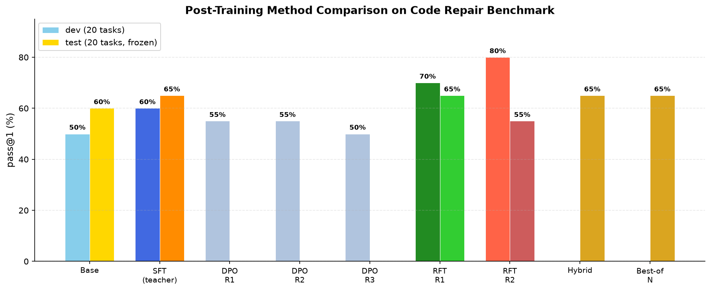
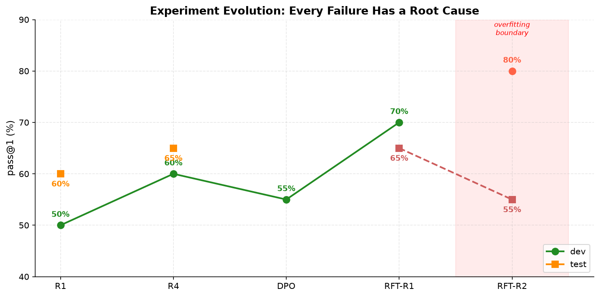
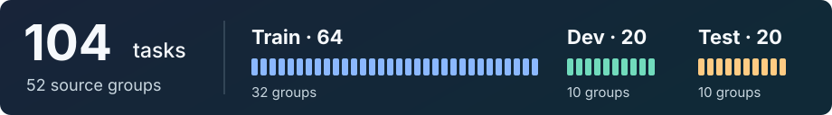

# CodeAgent-R

**代码修复模型的后训练与执行评测** · [English](README_EN.md)


CodeAgent-R 在 104 道 Python 修复题上评测 **Qwen2.5-Coder-7B-Instruct**。教师蒸馏、偏好优化和拒绝采样各能多修好几道题？候选修复要运行测试，各轮 checkpoint 要在 dev 上与基座模型（Base）比较，最后在冻结的 test 上逐题计分。

[方法对比](#方法对比) · [三种子](#三种子复现) · [实验演进](#实验演进) · [评测流程](#训练与评测流程) · [快速开始](#本地快速开始)

## 方法对比



**同一份 20 题 test 上，Base 修好 12 题，SFT 和第一轮 RFT 各修好 13 题。** 再做一轮 RFT，dev 从 14 题升到 16 题，test 却从 13 题降到 11 题。

| 方法 | dev | test | 实验设置与观察 |
| --- | ---: | ---: | --- |
| Base | 10/20 (50%) | 12/20 (60%) | 基座模型，greedy 解码 |
| **教师蒸馏 SFT** | 12/20 (60%) | **13/20 (65%)** | seed 42，dev 选中 epoch 3 |
| DPO 第 1 轮 | 11/20 (55%) | — | 冻结 SFT 作 reference，统一 β=0.1 |
| DPO 第 2 轮 | 11/20 (55%) | — | 同一 reference，按采样组使用 β=0.1 或 0.01 |
| DPO 第 3 轮 | 10/20 (50%) | — | 改用 Base 作 reference，训练 loss 从 0.72 降到 0.63 |
| **RFT 第 1 轮** | 14/20 (70%) | **13/20 (65%)** | 从 SFT 继续训练，用约 150 条自生成修复 |
| RFT 第 2 轮 | 16/20 (80%) | 11/20 (55%) | 继续训练，180 条自生成修复覆盖 58 题 |
| Hybrid 混合训练 | — | 13/20 (65%) | 202 条教师样本与约 150 条 RFT 样本混合 |
| Best-of-N 推理 | — | 13/20 (65%) | 先 greedy，必要时最多追加 4 次采样，以公开测试筛选 |

三轮 DPO 的 dev 成绩都低于 SFT，因此止于 dev。Hybrid 和 Best-of-N 仅有 test 成绩。已做终评的方案中，有 7 道 test 题始终未通过。[实验成绩单](docs/EXPERIMENT-RESULTS.md) · [DPO 训练记录](docs/EXPERIMENT-DPO.md)

## 三种子复现


三个训练种子共用同一份冻结 test。每次先在 dev 上选模型，Base 也参与，平局保留 Base。

| 训练 seed | dev 选中了谁 | 选中模型在 test 上通过 | 相对 Base |
| ---: | --- | ---: | ---: |
| 42 | epoch 3 | **13/20** | **+5 个百分点** |
| 43 | Base | 12/20 | 0 |
| 44 | epoch 2 | 12/20 | 0 |

平均提升 **1.7 个百分点**。seed 42 在 dev 上有 3 题改善、1 题退化，净多通过 2 题。在 test 上有 1 题改善、0 题退化，其余两次运行的 test 总分持平。按题重采样的 95% 区间为 **[0, +5] 个百分点**。每道题占 5 个百分点，解读平均增益时需要同时看分母和区间。[统计实现](scripts/aggregate_seeds.py) · [手机竖版图](docs/images/three-seed-results-mobile.png)

## 实验演进



图中左端 50% / 60% 是方法对照使用的基线值。前几轮曾更换任务池，下面按各轮实际使用的评测规模列出记录。

| 轮次 | 训练数据与改动 | 当轮观察 |
| --- | --- | --- |
| 1 · 初版 SFT | 71 条样本，dev/test 各 2 题 | 生成结果与 Base 逐字节相同 |
| 2 · 扩大任务池 | 84 题、204 条样本，dev/test 各 12 题 | dev 多通过 1 题，test 少通过 1 题 |
| 3 · 修正标签 | 每题保留 1 个解，共 60 条 | 监督 token 降至上一轮的约 26%，得分持平 |
| 4 · 冻结评测 | 104 题、202 条教师样本，加入变异审计和 3 个训练种子 | dev/test 各 20 题，选型后平均 test 增益 +1.7 个百分点 |
| 5–7 · DPO | 64 道 train 题各采样 6 次，得到 50 对偏好样本 | 三轮 dev 分别通过 11、11、10 题，SFT 通过 12 题 |
| 8 · RFT | 从 SFT 采样，约 150 条样本覆盖约 50 题 | dev 多通过 2 题，test 与 SFT 持平 |
| 9 · 再次 RFT | 从第一轮 RFT 继续采样，学习率由 1e-5 降到 5e-6 | 相比上一轮，dev 再多通过 2 题，test 少通过 2 题 |

### 如何解读这些差异

- **训练样本与任务覆盖。** 第 2 轮和第 4 轮的样本数几乎相同（204 和 202），任务池、标签审计和评测分母却都变了。跨轮比较时，一并记录独立任务数、来源组和监督 token 数，才能判断哪些条件发生了变化。
- **偏好训练的信号。** 学生的 384 次采样中有 207 次通过。使用 SFT reference 时，偏好准确率接近 1、reward margin 接近 0。要判断参数梯度大小，还需要梯度记录。部署选择可以直接依据 20 道 dev 题上修复成功的数量。[DPO 分析](docs/EXPERIMENT-DPO.md)
- **推理预算。** Best-of-N 会在 greedy 未通过公开测试时追加采样。它用更高的候选预算得到和 SFT greedy 相同的 13/20。比较时应同时列出最终通过数和每题允许生成的次数。

## 训练与评测流程



1. **按来源组冻结划分。** 同一来源组的两道修复题始终进入同一个集合。冻结前运行参考解与原始缺陷。变异审计中，104 题里有 75 题的测试捕获了本轮生成的全部变异体。[任务构造与判分](src/agentlab/benchmark/) · [变异审计](scripts/audit_mutations.py)
2. **重放教师候选。** 教师读取公开指令、缺陷代码、必要依赖和公开测试。通过判分的修复在数据准备阶段去重、重放。历史 SFT 记录在 64 道训练题上保留了 202 条样本，复用指纹匹配的既有候选使记录的采集开销减少了 56%。[数据准备](scripts/prepare_data.py) · [候选迁移](scripts/migrate_candidates.py)
3. **训练并保留各轮 adapter。** SFT 使用 NF4 双量化 QLoRA，LoRA 秩为 16、α 为 32，学习率 2e-5。只监督目标 assistant token，按监督 token 数累积损失，3 个 epoch 共更新 78 步。[SFT 训练实现](src/agentlab/training/hf_sft.py)
4. **在 dev 上选型，锁定后评测 test。** 用相同解码预算比较 Base 和各 epoch 的执行 pass@1。固定选型后，再按题记录 test 上的改善与退化。[checkpoint 选择](scripts/select_checkpoint.py) · [配对比较](scripts/compare.py)

两条后续训练路线从监督微调（SFT）出发。**直接偏好优化（DPO）** 将同一提示下的教师成功解与学生失败解配对，按采样组调整 β，并用抽象语法树指纹选择常见错误。**拒绝采样微调（RFT）** 每题先采样 8 次，保留通过测试的修复。失败样本可用诊断提示重试，训练时配回原始提示。[偏好对生成](scripts/generate_preferences.py) · [RFT 数据生成](scripts/generate_rft_data.py)

## 本地快速开始

在仓库根目录用 Python 3.10+ 运行。下面的 CPU 示例会打印模型实际可见的提示，最后的 `canary 在 prompt 中: False` 表示私有标记已被剔除。

```bash
python -m pip install -e .
python -m agentlab doctor
python examples/p01_minimal.py
```

完整离线测试可在 Linux 或 WSL2 上运行。

```bash
python -m pip install -e ".[dev]"
python -m pytest tests -q
```

GPU 训练与评测使用 `.[dev,train,api]`。复现 64/20/20 划分时，显式设 `--dev-ratio 0.20 --test-ratio 0.20`。教师采集会发送付费请求，先用 `--status-only` 检查候选槽位。[GPU 实验手册](docs/POSTTRAIN-GPU.md) · [上手指南](docs/START-HERE.md)

## 项目结构与边界

| 想了解的部分 | 代码与文档 |
| --- | --- |
| 任务规格、公开输入、补丁判分 | [benchmark](src/agentlab/benchmark/) · [contracts](src/agentlab/contracts/) |
| SFT / DPO 训练、实验编排与状态 | [training](src/agentlab/training/) · [experiments](src/agentlab/experiments/) · [scripts](scripts/) |
| 工作区、工具预算、轨迹与模型服务 | [runtime](src/agentlab/runtime/) · [trajectories](src/agentlab/trajectories/) · [providers](src/agentlab/providers/) |
| 实验明细、偏好优化与回归测试 | [实验成绩单](docs/EXPERIMENT-RESULTS.md) · [FEST 实现笔记](docs/FEST-ANALYSIS.md) · [tests](tests/) |

每个任务只替换一个 Python 主文件，依赖文件为只读上下文。判分会执行候选代码，运行不受信任的候选需要容器与资源隔离。完整工具交互和在线 RL 仍属后续工作。

公开报告使用汇总指标与公开模型版本。教师密钥、私有测试、逐题输出、原始日志和 checkpoint 留在本地。[分享实验结果](docs/START-HERE.md#分享实验结果)

## 相关研究

- **代码修复与执行反馈**　[SWE-Gym](https://arxiv.org/abs/2412.21139) · [FailForge](https://arxiv.org/abs/2608.08570) · [PerfCodeGen](https://arxiv.org/abs/2412.03578) · [Self-Execution Simulation](https://arxiv.org/abs/2604.03253)
- **自生成数据与拒绝采样**　[GiFT](https://arxiv.org/abs/2502.11466) · [RFT](https://arxiv.org/abs/2308.01825)
- **偏好优化与组内反馈**　[DPO](https://arxiv.org/abs/2305.18290) · [FEST](https://arxiv.org/abs/2605.15012) · [GRPO](https://arxiv.org/abs/2402.03300)

项目独立实现，运行时设计受 pi 启发。[pi](https://github.com/earendil-works/pi) · [MIT 许可证](LICENSE)
