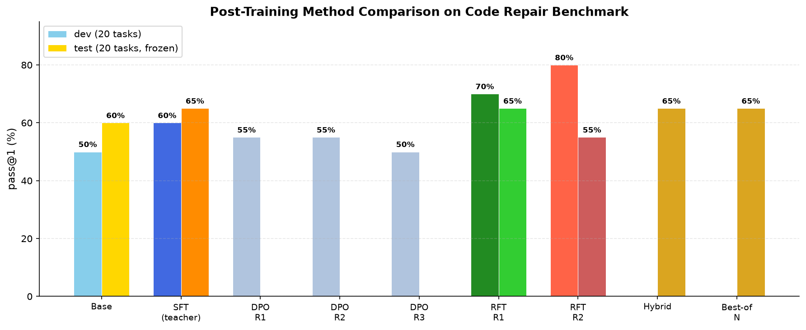
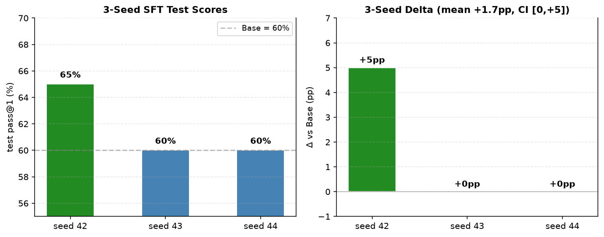
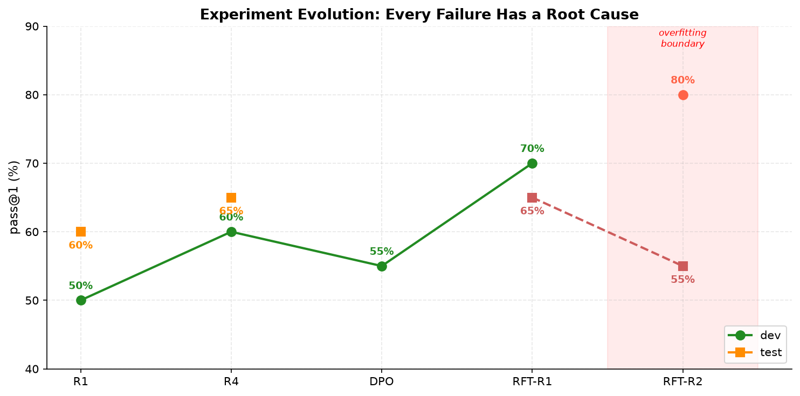

# CodeAgent-R


[中文](README.md) | **English**

A post-training experiment platform for code repair. Systematically evaluated 6 post-training methods on Qwen2.5-Coder-7B (teacher distillation SFT, DPO ×3, RFT ×2, hybrid training, Best-of-N inference), each with root-cause analysis.

## Method Comparison



## Final Scorecard

| Method | dev | test | Verdict |
|---|---|---|---|
| Base greedy | 50% | 60% | Baseline |
| SFT (teacher distillation) | 60% | **65%** | ✅ Deployed |
| DPO round 1 (SFT ref, uniform β) | 55% | — | ❌ σ→0 vanishing gradients |
| DPO round 2 (SFT ref, adaptive β) | 55% | — | ❌ Same (β is not the root cause) |
| DPO round 3 (Base ref) | 50% | — | ❌ Learned ranking but execution regressed |
| **RFT round 1 (self-improvement)** | **70%** | **65%** | ✅ **Best deployable** |
| RFT round 2 | 80% | 55% | ❌ Overfitting boundary |
| Hybrid (teacher + RFT) | — | 65% | No breakthrough |
| Best-of-N inference (4 samples) | — | 65% | No breakthrough |

**Test ceiling = 65%**: 7 tasks fail across all methods; hard limit of current 7B model + 104-task pool.

### 3-Seed Replication (SFT)

| Seed | Dev decision | Test | Δ (pp) |
|---|---|---|---|
| 42 | epoch-3 deployed | 65% | +5.0 |
| 43 | **Kept Base** (no dev gain) | 60% | 0 |
| 44 | epoch-2 deployed | 60% | 0 |
| **Pooled** | — | — | **Mean +1.7, CI [0, +5], zero regressions** |



## Experiment Evolution



| Round | Change | Samples | Eval | Outcome | Root cause |
|---|---|---|---|---|---|
| 1 | Initial SFT | 71 | 2/2 tasks | Output byte-identical to Base | Data too small; learned style not semantics |
| 2 | Expanded to 84 tasks | 204 | 12/12 tasks | dev +1 / test −1 | Eval noise; hidden tests underdetermined labels |
| 3 | Fixed labels, 1 solution/task | 60 | 12/12 tasks | No change | Supervised tokens cut to 26% — starvation |
| **4** | **104 tasks + mutation audit + 3 seeds** | **202** | **20/20 tasks** | **+1.7pp, zero regressions** | Data ×2.8 + quality gate + resolution ×1.7 |
| 5–7 | DPO three rounds | 50 pairs | dev 20 | All negative | σ→0 / preference≠execution / overfitting |
| 8 | RFT round 1 | 150 self-gen | dev 20 | **dev +10pp** | In-distribution self-reinforcement works |
| 9 | RFT round 2 | 180 self-gen | dev 20 | dev +10 test −10 | Iterative self-improvement has a boundary |

## Methodological Findings

1. **Teacher distillation has a distribution-shift ceiling**: teacher answer style differs from model's own distribution; SFT plateaus at 65%
2. **DPO has three distinct failure modes**: SFT self-reference causes vanishing gradients; adaptive β can't fix structural issues; Base reference yields real gradients but preference ranking ≠ execution capability
3. **RFT in-distribution self-reinforcement is most effective**: Round 1 +10pp dev; Round 2 starts overfitting (dev↑ test↓)
4. **Iterative self-improvement has a boundary**: each round narrows output distribution; test regresses from Round 2
5. **Source-group isolation + execution-based selection is the critical safeguard**: DPO below SFT not deployed; RFT-R2 test regression intercepted; seed 43 no-gain keeps Base

## Core Pipeline

| Capability | Implementation |
|---|---|
| Task benchmark | 104 tasks / 52 source groups, mutation-testing audit |
| Data isolation | Source-group frozen splits (64/20/20), fingerprint migration (56% savings) |
| SFT | NF4 QLoRA, assistant-only mask, supervised-token-weighted accumulation, per-epoch immutable checkpoints |
| Model selection | Dev **execution pass@1**, Base included, ties keep Base |
| DPO | FEST adaptive β + hard-negative AST clustering + Base reference |
| RFT | Rejection sampling + [FailForge](https://arxiv.org/abs/2608.08570) failure recovery |
| Inference | Greedy + Best-of-N (public-test filtered sampling) |

## Quick Start

```bash
python -m pip install -e ".[dev]"
python -m pytest tests -q           # 470 tests
python -m agentlab doctor
```

GPU training and evaluation:

```bash
python -m pip install -e ".[dev,train,api]"
python -m pip check
```

Full pipeline: [START-HERE](docs/START-HERE.md) | [Experiment Results](docs/EXPERIMENT-RESULTS.md) | [GPU Guide](docs/POSTTRAIN-GPU.md)

## Pipeline Architecture

```text
Task pool (mutation-audited) → source-group frozen splits → train / dev / test
      ↓ train / dev only
Public instruction + buggy code + dependencies + public tests
      ↓
Teacher candidates → three-layer grading → replay verification → SFT data
      ↓
QLoRA SFT → per-epoch snapshots → dev execution selection → frozen-test eval
      ↓ (optional)
RFT self-improvement → DPO preference optimization → Best-of-N inference
```

## Project Structure

```text
scripts/           Data prep, collection, training, evaluation, RFT, merge, privacy audit
src/agentlab/
  benchmark/       Tasks, public protocol, three-layer grader, mutation audit
  training/        SFT / DPO trainers, data preparation
  runtime/         Workspaces, execution, budgets, snapshots
  trajectories/    Same-state branching and preference construction
  experiments/     Experiment contracts and run state
  providers/       OpenAI-compatible providers
docs/              Experiment results, methodology docs
tests/             Automated tests (no real model/API required)
```

## Known Limitations

- Grading executes model code; production use needs container and resource isolation.
- Full agent tool interaction and online RL not yet implemented.
- Current tasks are single-file flat-Python repairs; multi-file repair requires protocol extension.
- 7 test tasks fail across all tried methods; 65% is the ceiling for current 7B model + 104-task pool.
- `data/`, `results/`, `checkpoints/` not committed.

Inspired by [pi](https://github.com/earendil-works/pi), independently implemented.

## References

- [SWE-Gym](https://arxiv.org/abs/2412.21139) — execution-feedback agent training (ICML 2025)
- [FailForge](https://arxiv.org/abs/2608.08570) — failure recovery via diagnostic hints (2026)
- [PerfCodeGen](https://arxiv.org/abs/2412.03578) — runtime execution feedback for iterative refinement
- [Self-Execution Simulation](https://arxiv.org/abs/2604.03253) — training models to simulate execution
- [GiFT](https://arxiv.org/abs/2502.11466) — self-generated data improves fine-tuning
- [FEST](https://arxiv.org/abs/2605.15012) — adaptive β / hard-negative selection for DPO
- [DPO](https://arxiv.org/abs/2305.18290) — Direct Preference Optimization (NeurIPS 2023)
- [RFT](https://arxiv.org/abs/2308.01825) — Rejection Sampling Fine-Tuning
- [GRPO](https://arxiv.org/abs/2402.03300) — Group Relative Policy Optimization

License: MIT.
