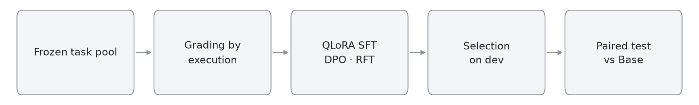
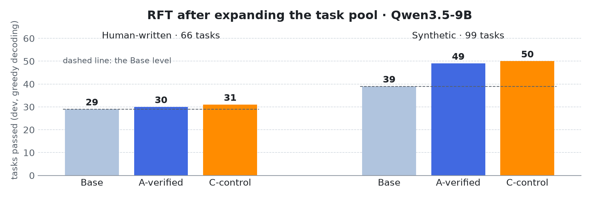
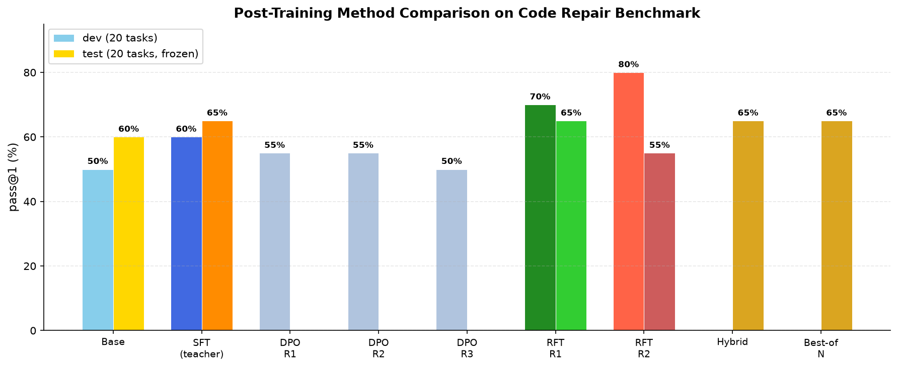
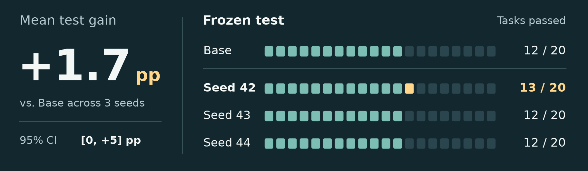
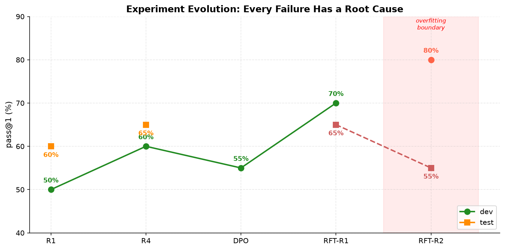
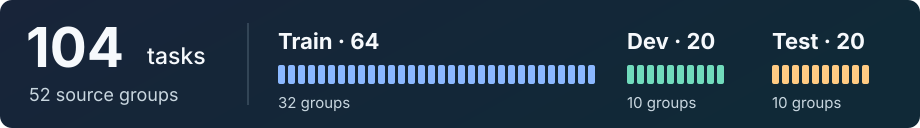

# CodeAgent-R

**Post-training for code repair** · [中文](README.md)

[](https://github.com/Phoenix-chaser/CodeAgent-R/actions/workflows/checks.yml)     

CodeAgent-R is a reproducible pipeline for post-training and execution-based evaluation of code repair: a frozen task pool, grading by execution, QLoRA SFT / DPO / RFT, selection on dev, and a paired comparison with the base model (Base) on frozen test data.

The default model is **Qwen3.5-9B**, and the results on this page are centered on it; see "Results on Qwen3.5-9B" below. The later section "Earlier results on Qwen2.5-Coder-7B-Instruct" covers the experiments run before the switch to it, on a pool of 104 self-authored repairs of single Python files; set `MODEL=Qwen/Qwen2.5-Coder-7B-Instruct` to reproduce those results.



[Qwen3.5-9B results](#results-on-qwen35-9b) · [Scorecard](#method-comparison) · [Three seeds](#three-training-seeds) · [Experiment history](#experiment-history) · [Pipeline](#training-and-evaluation) · [What keeps the results trustworthy](#what-keeps-the-results-trustworthy) · [Quick start](#run-locally)

## Table of contents

1. [Results on Qwen3.5-9B](#results-on-qwen35-9b): takeaways, RFT after expanding the pool, synthetic-task difficulty, the default pool, the difficulty ladder, RFT against its control, guided sampling, the two evaluation stacks compared, and next steps
2. [What keeps the results trustworthy](#what-keeps-the-results-trustworthy): grading, isolation, statistics, evidence, CI
3. [Earlier results on Qwen2.5-Coder-7B-Instruct](#earlier-results-on-qwen25-coder-7b-instruct): the experiments run before the switch to Qwen3.5-9B
   - [Method comparison](#method-comparison): dev and test scores for Base, SFT, three DPO rounds, two RFT rounds, hybrid training, and Best-of-N
   - [Three training seeds](#three-training-seeds): each seed's dev selection and its result on the frozen test set
   - [Experiment history](#experiment-history): data and changes per round, and what was observed
     - [Interpreting the differences](#interpreting-the-differences)
4. [Training and evaluation](#training-and-evaluation): frozen split, teacher-candidate replay, training, dev selection, and test evaluation
5. [Run locally](#run-locally): CPU example, offline test suite, GPU training and evaluation
6. [Repository and scope](#repository-and-scope): where the code and documentation live, and what is not implemented yet
7. [Related work](#related-work): code repair and execution feedback, self-generated data, preference optimization

## Results on Qwen3.5-9B

**Takeaways.** On Qwen3.5-9B, the whole pipeline ran end to end: teacher collection, RFT, guided sampling, synthetic task generation, and RFT after expanding the pool. The gain from fine-tuning is in-distribution: after the pool was expanded, dev as a whole rose by about 7 points, almost all of it on synthetic tasks, and nothing changed on the human-written tasks. In all four experiments, the control arm trained on wrong answers scored as high as the verified arm, so at this data scale no gain can be attributed to "correct answers". The gains also appear only under NF4 evaluation: when the same models were re-evaluated with vLLM (bf16), greedy decoding passed 84 tasks for Base, 85 for A-verified, and 76 for C-control, and the gain did not show up (see "The two evaluation stacks compared").

**RFT after expanding the pool (165 dev tasks).** RFT was run again on the expanded ladder, sampling the two synthetic tiers as well. Training used 334 examples, one per task, of which 269 came from synthetic tasks; the total is 5.5 times round 1's 61. Tasks passed on the 165 dev tasks under greedy decoding:

| Arm | Original | Hard | Variants | Synthetic hard | Synthetic variants | Total | Human-written (66) |
| --- | ---: | ---: | ---: | ---: | ---: | ---: | ---: |
| Base | 14/20 | 0/8 | 15/38 | 0/15 | 39/84 | 68/165 | 29/66 |
| A-verified | 14/20 | 0/8 | 16/38 | 1/15 | 48/84 | 79/165 | 30/66 |
| C-control | 16/20 | 0/8 | 15/38 | 0/15 | 50/84 | 81/165 | 31/66 |



Both trained arms passed 11 to 13 more dev tasks than Base, but almost all of the gain is on synthetic tasks. On synthetic variants, A-verified newly passed 16 tasks and lost 7 relative to Base; C-control newly passed 12 and lost 1. On the 66 human-written tasks the sequence is 29 → 30 → 31, within noise, as in round 1.

**Difficulty of the synthetic tasks.** With the synthetic tasks added, Base was sampled 8 times per training task:

| Tier | Tasks solved | Passing samples |
| --- | ---: | ---: |
| Multi-defect hard tasks (human-written) | 2/24 | 3/192 (1.6%) |
| Single-defect variants (human-written) | 63/110 | 146/880 (16.6%) |
| Synthetic parent tasks | 23/53 | 88/424 (20.8%) |
| Synthetic variants | 246/299 | 1122/2392 (46.9%) |


The synthetic tasks are of medium difficulty: easier than the human-written ones, the variants especially.

The results above are the main findings of this round; below, each experiment is listed in chronological order.

**Setup.** The numbers in this section come from the experiments run after the default model was switched to Qwen3.5-9B. The task pool became a difficulty ladder: the 104 original tasks plus the hard pool (40 multi-defect tasks and 183 single-defect variants), 327 in all, with a frozen split by source family: train 198 / dev 66 / test 63. Evaluation is greedy decoding with NF4 quantization, reported by tier (original, hard, and variants; once the synthetic tasks were added, synthetic hard and synthetic variants as well). Test is scored only once, at the very end. Two batches of synthetic tasks were added later: 545 tasks generated by the teacher and audited by executing each one. They follow the hard pool's structure, with one multi-defect parent task plus several single-defect variants per family. The ladder then held 872 tasks: train 550 / dev 165 / test 157.

**Default pool (104 tasks).** Before the move to the ladder, the full pipeline was run on the default pool:

| Method | Dev | Test |
| --- | ---: | ---: |
| Base | 11/20 | 16/20 |
| Teacher-distilled SFT | 11/20 | — |
| RFT | 14/20 | 17/20 |
| RFT + Best-of-N | 15/20 | 18/20 |

Teacher-distilled SFT has a dev score only. It matched Base, so there was no gain, and after two or three epochs of training the score fell to 9/20. These 20 test tasks have been evaluated 4 times, and the lower bound of the confidence interval for the Best-of-N result (18/20 on test) is 0, so treat that result as a directional signal only.

**Hard pool and difficulty ladder.** Base passed 0/40 of the 40 multi-defect hard tasks under greedy decoding. The teacher passed 94% of the same tasks, so they are solvable. SFT on the teacher's answers was tried five times on the hard-task source families and never helped; in one run, dev went from 15/46 down to 10/46 and then to 12/46. On the 327-task ladder, Base with greedy decoding passed 29/66 on dev (original 14/20, hard 0/8, variants 15/38) and 29/63 on test (original 18/20, hard 0/8, variants 11/35).

**RFT on the ladder (66 dev tasks).** Base sampled its own answers on the ladder's training tasks, and the arms were trained on different selections from those samples. Tasks passed on the 66 dev tasks under greedy decoding:

| Arm | Training data | Dev tasks passed |
| --- | --- | ---: |
| Base | — | 29 |
| A-verified | Answers that passed grading | 31 |
| C-control | Failing answers for the same tasks | 32 |
| B-oldhp | Same data as A-verified, older hyperparameters | 27 |

The control arm, trained on wrong answers, scored as high as the verified arm.

**Guided sampling.** In round 1, there were 72 training tasks that Base failed on all 8 samples, so the verified arm had no correct answers for them. These 72 tasks were sampled again with a hint:

- **Prefix hint.** The opening of the reference solution at 25%, 50%, or 75%, 4 samples per length. This solved 47 tasks; the three lengths solved 8, 26, and 43, and the sets overlap.
- **Skill hint.** A general-purpose skill written by the teacher, 8 samples per task. This solved 31 tasks.

After training, on the 66 dev tasks, the prefix-guided arm (D-prefix) passed 28, the skill-guided arm (D-skill) 32, and the paired control (F-control) 29, against 29 for Base. All of these are within noise. More than 95% of the prefix-guided samples copy the reference solution.

**The two evaluation stacks compared.** Unless stated otherwise, the numbers on this page come from transformers + NF4. The same models were also evaluated on the 165 dev tasks with vLLM (bf16), both greedy decoding and 4 samples per task:

| Arm | Trained in | vLLM greedy passes | Sample pass rate (4 × 165) | pass@4 | For comparison: NF4 greedy passes |
| --- | --- | ---: | ---: | ---: | ---: |
| Base | — | 84/165 | 42.4% (280/660) | 65.5% | 68/165 |
| A-verified | NF4 | 85/165 | 48.0% (317/660) | 68.5% | 79/165 |
| C-control | NF4 | 76/165 | 45.8% (302/660) | 64.8% | 81/165 |
| Base (a second run) | — | 85/165 | 43.3% (286/660) | 64.2% | — |
| A-verified | bf16 | 85/165 | 50.2% (331/660) | 66.7% | — |
| C-control | bf16 | 82/165 | 45.5% (300/660) | 66.7% | — |

The same Base model passed 16 more tasks under bf16 than under NF4 (the dev 66 tasks point the same way: 33 against 29). The two stacks differ in weight precision and in prompt rendering, so this gap cannot be attributed to quantization alone. The NF4 gains in the table above (+11 and +13) do not appear under bf16: greedy decoding gives +1 and −8, and the sample pass rate gives +5.6 and +3.4 points. Compare numbers only within the same evaluation stack.

The last two rows are the two arms retrained in bf16 (`scripts/rft_precision_probe.sh`: the same 334 examples and hyperparameters, changing only the training precision), so training precision is not the cause. Greedy passes by tier: on the 66 human-written tasks no arm is above Base. The NF4-trained A-verified passed 27 (Base passed 32; the loss is entirely on the human-written variants, 17 → 12) and C-control passed 28; the bf16-trained A-verified passed 31 and C-control passed 32. On the 99 synthetic tasks only the NF4-trained A-verified rose noticeably (52 → 58); every other arm is within 3 tasks. In other words, the gain appears only on in-distribution synthetic tasks, and it comes at the expense of the human-written ones.

**Next steps.** The direction is to filter training data by difficulty, to run preference optimization on correct and incorrect samples from the same task, and to move checkpoint selection to the vLLM (bf16) evaluation.

## What keeps the results trustworthy

- **Grading.** A pass means the tests the reference solution ran were all executed on the candidate and all passed. Three signals must agree: exit code, the pytest summary line, and the junit XML. Exiting early, skipping tests, or collecting fewer tests is a fail.
- **Isolation.** Candidate code runs inside a kernel Landlock sandbox. The workspace is read-only, the real HOME and /proc are unreachable, TCP connections are denied, and the process is bounded by CPU time, memory, process count, and a process-group kill on timeout. The environment is built from an allowlist. When the kernel lacks Landlock the grader falls back and records the isolation that was actually used.
- **Statistics.** The bootstrap samples source groups, the same independent unit used for the split and the leak checks.
- **Evidence.** `scripts/export_evidence.py` exports sanitized local artifacts to `docs/evidence/`. Once a bundle is committed, CI recomputes its conclusions from the per-task results with `scripts/verify_evidence.py`.
- **CI.** Lint, CPU tests, evidence verification, and the privacy check, see [checks.yml](.github/workflows/checks.yml).

[Findings and fixes from the latest review](docs/REVIEW-2026-11-23.md) (in Chinese)

## Earlier results on Qwen2.5-Coder-7B-Instruct

**The pipeline works. It has not shown a reliable gain.** On 20 frozen test tasks, Base repaired 12 and teacher-distilled SFT repaired 13.

Across three training seeds the mean gain was 1.7 percentage points with a 95% interval of [0, +5], and two of the seeds selected Base on dev. No DPO round beat SFT.

Test has only 20 tasks, all self-authored, which is too small to support a generalization claim.

### Method comparison



**On the same 20 test tasks, Base repaired 12 programs. SFT and the first RFT round each repaired 13.** A second RFT round brought dev up from 14 to 16 repairs while test fell from 13 to 11.

| Method | Dev | Test | Setting and observation |
| --- | ---: | ---: | --- |
| Base | 10/20 (50%) | 12/20 (60%) | Base model, greedy decoding |
| **Teacher-distilled SFT** | 12/20 (60%) | **13/20 (65%)** | Seed 42 selected epoch 3 on dev |
| DPO round 1 | 11/20 (55%) | — | Frozen SFT reference, uniform β=0.1 |
| DPO round 2 | 11/20 (55%) | — | Same reference, β=0.1 or 0.01 by sampling group |
| DPO round 3 | 10/20 (50%) | — | Base reference, training loss fell from 0.72 to 0.63 |
| **RFT round 1** | 14/20 (70%) | **13/20 (65%)** | Continued from SFT on about 150 self-generated repairs |
| RFT round 2 | 16/20 (80%) | 11/20 (55%) | Continued from round 1 on 180 repairs covering 58 tasks |
| Hybrid training | — | 13/20 (65%) | Mixed 202 teacher examples with about 150 RFT examples |
| Best-of-N inference | — | 13/20 (65%) | Greedy first, then up to four extra samples screened by public tests |

All three DPO runs scored below SFT on dev and stopped there. The hybrid and Best-of-N runs report test scores only. Seven test tasks remained unsolved across the methods that reached final evaluation. [Full scorecard](docs/EXPERIMENT-RESULTS.md) · [DPO run notes](docs/EXPERIMENT-DPO.md)

### Three training seeds



All three training seeds share one frozen test set. Each run selects on dev first, with Base included as a candidate. Ties keep Base.

| Training seed | Dev selection | Test tasks passed | Gain over Base |
| ---: | --- | ---: | ---: |
| 42 | Epoch 3 | **13/20** | **+5 pp** |
| 43 | Base | 12/20 | 0 |
| 44 | Epoch 2 | 12/20 | 0 |

The mean gain was **1.7 percentage points**. On dev, seed 42 improved three tasks and regressed on one, for a net gain of two. On test, it fixed one additional task with zero regressions. The other two runs matched the baseline score.

The 95% task-bootstrap interval was **[0, +5] percentage points**. A single repair moves the score by five points on a test set of this size. That interval resamples individual tasks, which is the historical setting. The scripts now resample whole source groups by default, so recomputing it from the original results may widen it. [Aggregation code](scripts/aggregate_seeds.py) · [Mobile chart](docs/images/three-seed-results-mobile.png)

### Experiment history



The 50% dev and 60% test markers on the left are the baseline values used in the method comparison. The early rounds used smaller evaluation sets. Their actual sizes appear below.

| Round | Data or training change | Observation within that round |
| --- | --- | --- |
| 1 · Initial SFT | 71 examples, two tasks each on dev and test | Outputs were byte-identical to Base |
| 2 · Larger pool | 84 tasks, 204 examples, 12 tasks each on dev and test | One more dev repair and one fewer test repair |
| 3 · Label fixes | One solution per task, 60 examples | Supervised tokens fell to about 26% of the previous total and scores held steady |
| 4 · Frozen evaluation | 104 tasks, 202 teacher examples, a mutation audit and three training seeds | 20 tasks each on dev and test, mean test gain of +1.7 pp after selection |
| 5–7 · DPO | Six samples per train task across 64 tasks yielded 50 preference pairs | The three runs passed 11, 11, and 10 dev tasks. SFT passed 12 |
| 8 · RFT | About 150 self-generated examples across roughly 50 tasks | Two more dev repairs. Test matched SFT |
| 9 · Further RFT | Resampled from round 1 and reduced the learning rate from 1e-5 to 5e-6 | Two more dev repairs and two fewer test repairs than round 1 |

#### Interpreting the differences

- **Examples and task coverage.** Rounds 2 and 4 had nearly identical example counts (204 and 202), yet the task pool, label audit, and evaluation set size all changed. Comparing rounds calls for independent task counts, source groups, and supervised-token counts.
- **The preference signal.** The student passed 207 of 384 samples. With an SFT reference, preference accuracy was near 1 and reward margin near zero. Establishing the size of parameter gradients would require gradient measurements. Model selection can use the observed repair count on the 20 dev tasks. [DPO analysis](docs/EXPERIMENT-DPO.md)
- **The inference budget.** Best-of-N generates extra candidates when greedy fails a public test. Its higher candidate budget produced the same 13/20 as greedy SFT. Reporting both repairs and allowed generations per task makes the cost of the comparison visible.

## Training and evaluation



1. **Freeze whole source groups.** Both tasks in a group stay in the same split. The export checks each reference repair and reproduces each original bug. In the mutation audit, 75 of 104 tasks caught every mutant generated for them. The opt-in hard pool `h3` adds forty multi-defect tasks (state consistency, transactions, exception safety, concurrency), and `h3s` holds their single-defect variants; enable them with `EXTRA_POOLS=h3` or `EXTRA_POOLS="h3 h3s"`. The default benchmark is unchanged. [Benchmark and grader](src/agentlab/benchmark/) · [Mutation audit](scripts/audit_mutations.py)
2. **Replay teacher candidates.** The teacher receives the instruction, buggy code, dependencies, and public tests. Data preparation deduplicates and replays passing repairs. The reported SFT run retained 202 examples from 64 training tasks. Reusing candidates with matching fingerprints reduced the reported collection cost by 56%. [Data preparation](scripts/prepare_data.py) · [Candidate migration](scripts/migrate_candidates.py)
3. **Train and keep each epoch.** SFT used double-quantized NF4 QLoRA, rank 16, α=32, and a learning rate of 2e-5. Only target assistant tokens contributed to the loss. Gradient accumulation was weighted by supervised-token count, with 78 optimizer steps over three epochs. [SFT implementation](src/agentlab/training/hf_sft.py)
4. **Select on dev, then evaluate on test.** Compare Base and every epoch on dev execution pass@1 with the same decoding budget. Once selection is fixed, count gains and regressions on matched test tasks. [Checkpoint selection](scripts/select_checkpoint.py) · [Paired comparison](scripts/compare.py)

Two follow-up training paths start from supervised fine-tuning (SFT).

**Direct preference optimization (DPO)** pairs a passing teacher solution with a student failure under the same prompt. The adaptive variant chooses β by sampling group and uses syntax-tree fingerprints to select common failures.

**Rejection sampling fine-tuning (RFT)** samples eight times per task and keeps verified repairs. A diagnostic hint can help recover a failed attempt, and the resulting training example uses the original prompt. [Preference generation](scripts/generate_preferences.py) · [RFT data generation](scripts/generate_rft_data.py)

## Run locally

From the repository root, use Python 3.10 or later. This CPU example prints the model-visible task prompt. The final `canary 在 prompt 中: False` confirms that the private marker was removed.

```bash
python -m pip install -e .
python -m agentlab doctor
python examples/p01_minimal.py
```

Run the full offline suite on Linux or WSL2. It needs no GPU, model weights, or network. The kernel sandbox used for grading requires Linux 5.13 or later; older kernels fall back, and `agentlab doctor` reports what was used.

```bash
python -m pip install -e ".[dev,lint]"
python -m pytest tests -q
ruff check .
python -m agentlab doctor      # the sandbox.* rows show the isolation grading actually gets
```

GPU training and evaluation use the `.[dev,train,api]` extra. The default model, Qwen3.5, needs transformers 5.2.0 or later. To reproduce the Qwen2.5 results, the stage script switches to `train-qwen25` based on `MODEL`. To reproduce the 64/20/20 split, set `--dev-ratio 0.20 --test-ratio 0.20` explicitly.

Teacher collection sends paid requests. Use `--status-only` to inspect candidate slots first. Both guides are in Chinese. [GPU guide](docs/POSTTRAIN-GPU.md) · [Getting started](docs/START-HERE.md)

## Repository and scope

| Area | Code and documentation |
| --- | --- |
| Task specifications, public inputs, and patch grading | [benchmark](src/agentlab/benchmark/) · [contracts](src/agentlab/contracts/) |
| SFT and DPO training, experiment stages and state | [training](src/agentlab/training/) · [experiments](src/agentlab/experiments/) · [scripts](scripts/) |
| Workspaces, tool budgets, trajectories, and providers | [runtime](src/agentlab/runtime/) · [trajectories](src/agentlab/trajectories/) · [providers](src/agentlab/providers/) |
| Detailed runs, the per-group β heuristic, and regression tests | [Run records](docs/EXPERIMENT-RESULTS.md) · [Adaptive β notes](docs/ADAPTIVE-BETA.md) · [tests](tests/) |

Each task replaces a single Python file. Dependencies are read-only context.

Candidates are model-generated code, so grading runs them inside a [Landlock sandbox](src/agentlab/runtime/isolation.py) by default. A container backend is not implemented. Adversarial code inside the pytest process can still forge its own output; use containers when that boundary matters. Full tool-use episodes and online RL remain future work.

Public reports share aggregate metrics and public model revisions. Teacher credentials, private tests, raw model outputs, raw logs, and checkpoints stay local. `scripts/export_evidence.py` exports sanitized per-task verdicts and the training manifest. [Sharing results](docs/START-HERE.md#分享实验结果)

## Related work

- **Code repair and execution feedback** · [SWE-Gym](https://arxiv.org/abs/2412.21139) · [FailForge](https://arxiv.org/abs/2608.08570) · [PerfCodeGen](https://arxiv.org/abs/2412.03578) · [Self-Execution Simulation](https://arxiv.org/abs/2604.03253)
- **Self-generated data and rejection sampling** · [GiFT](https://arxiv.org/abs/2502.11466) · [RFT](https://arxiv.org/abs/2308.01825)
- **Preferences and group feedback** · [DPO](https://arxiv.org/abs/2305.18290) · [GRPO](https://arxiv.org/abs/2402.03300). Choosing β per sampling group is this project's own heuristic; see the notes for its relation to [FEST](https://arxiv.org/abs/2605.15012)

CodeAgent-R is an independent implementation. Its runtime design draws on pi. [pi](https://github.com/earendil-works/pi) · [MIT license](LICENSE)
